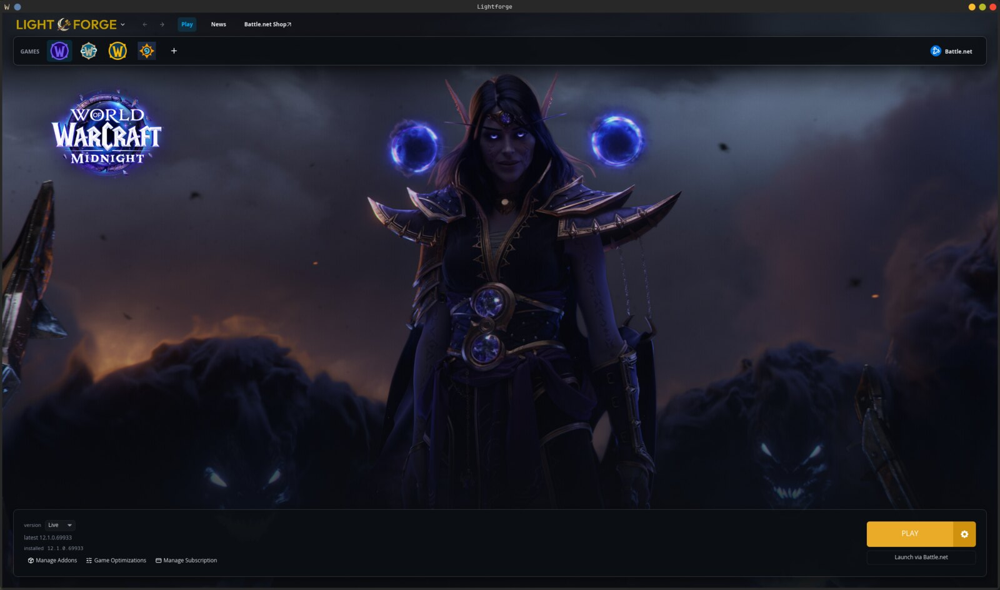

<div align="center">


**A native Linux launcher for World of Warcraft, and a proper home for the rest of Battle.net.**

[](https://github.com/LightforgeProject/lightforge/actions/workflows/ci.yml)
[](LICENSE)
[](RELEASES.md)
[](#install)
[](https://discord.gg/vtTgmUV9Bq)

</div>



---

Lightforge installs, patches, verifies and launches World of Warcraft on Linux
without the Battle.net client. It speaks Blizzard's own distribution protocols
(TACT and NGDP for the CDN, CASC for local storage), reimplemented in Rust, so
your game lands in a store the real client can read: point Battle.net at the
folder and it adopts it, no re-download.

For everything else (Diablo, Overwatch, Hearthstone, StarCraft) it keeps one
well-maintained Battle.net prefix and hands off to the client. They get a tile
here and start with one press.

## Install

Every package and the installer are on the
[releases page](https://github.com/LightforgeProject/lightforge/releases).

### Debian, Ubuntu, Linux Mint, Pop!_OS

Download the `.deb`, then:

```bash
sudo apt install ./lightforge_*_amd64.deb
```

### Fedora

From [COPR](https://copr.fedorainfracloud.org/coprs/simplykenny/lightforge/),
which keeps it updated with the rest of your system:

```bash
sudo dnf copr enable simplykenny/lightforge
sudo dnf install lightforge
```

Or download the `.rpm` and install it directly:

```bash
sudo dnf install ./lightforge-*.x86_64.rpm
```

### openSUSE

Download the `.rpm`, then:

```bash
sudo zypper install ./lightforge-*.x86_64.rpm
```

### Arch Linux, CachyOS, EndeavourOS, Manjaro

There's a PKGBUILD in the repository (AUR registrations are closed, so it isn't
on the AUR yet):

```bash
git clone https://github.com/LightforgeProject/lightforge.git
cd lightforge/packaging/aur/lightforge-bin && makepkg -si
```

### SteamOS, Bazzite and everything else

Download `lightforge-installer.desktop` and double-click it. It fetches the
newest version, verifies it, installs it into your home folder and starts
Lightforge, no terminal needed. Run it again any time to update. Or from a
terminal:

```bash
curl -fsSL https://raw.githubusercontent.com/LightforgeProject/lightforge/main/packaging/installer/install.sh | bash
```

Bazzite/Fedora Atomic specific:

```bash
sudo dnf5 copr enable simplykenny/lightforge
sudo rpm-ostree install lightforge
sudo systemctl reboot
```

##

### From source

```bash
git clone https://github.com/LightforgeProject/lightforge.git
cd lightforge
cargo build --release --locked
./target/release/lightforge-gui
```

[**INSTALL.md**](INSTALL.md) has the details: the Steam Deck, the 32-bit
package Battle.net's installer needs, and how to remove Lightforge again.

## Tested distros

🟢 tested and working · 🟠 testing still to do · 🔴 not working

| Distro | Status | Notes |
| --- | :---: | --- |
| CachyOS | 🟢 | PKGBUILD, Lightforge was developed on CachyOS |
| Arch Linux | 🟢 | PKGBUILD, Tested on hardware |
| EndeavourOS | 🟠 | Not tested yet but PKGBUILD should work |
| Manjaro | 🟠 | Same as EndeavourOS |
| Fedora | 🟢 | COPR repo / RPM install, Tested on hardware |
| Bazzite | 🟢 | install-script, Desktop and ROG Ally X, reported by players. |
| SteamOS | 🟠 | install-script, Tested in a VM; a real Steam Deck is next. |
| Nobara | 🟢 | COPR repo / RPM install, Tested on hardware |
| Debian | 🟢 | deb file, Tested in a VM. |
| Ubuntu | 🟠 | not tested yet but should work with deb file |
| Linux Mint | 🟠 | same as ubuntu |
| Pop!_OS | 🟠 | same as ubuntu |
| openSUSE Tumbleweed | 🟠 | not tested yet |
| NixOS | 🟠 | not tested yet |

Running it on something else, or on one of the orange ones? Tell me how it
went in [Discord](https://discord.gg/vtTgmUV9Bq) or through the in-app
reporter (`☰ › Report a bug`).

## Requirements

| | |
| --- | --- |
| **OS** | Any current Linux. glibc 2.36+ for the release binaries. |
| **GPU** | Vulkan if you have it; it falls back to software rendering if you don't. |
| **32-bit** | Only for Battle.net, whose installer and client are 32-bit. WoW alone doesn't need it. |

Proton-GE is downloaded and verified by Lightforge itself. You don't need
Steam, Lutris or a system Wine.

## What it does

- **Installs and updates WoW itself:** Retail, Classic, Classic Era,
  Anniversary and WoW: Forever, with their PTR and beta branches. Resumable
  downloads, real CASC storage, and verification of every stored byte.
- **Finds the games you already have** and adopts them where they are, from
  Lutris, Bottles, Heroic, Faugus or a hand-made prefix.
- **Puts games on any drive** you add, Battle.net's own included.
- **Manages addons** from CurseForge, WoWInterface, Tukui and GitHub, with
  update channels, changelogs, pinning, and WoWUp import and export.
- **Tunes the game** with presets, Proton's Wayland backend with HDR, frame
  caps and your own environment variables.
- **Sets Battle.net up for you**, then launches its games with one press. The
  in-game shop works too, [which took some finding](TECHDOC.md#the-in-game-shop).
- **Plays well on a controller**, with a handheld mode for the Steam Deck and
  similar devices.
- **Stays out of your way:** one native binary, no background service, nothing
  running when the launcher is closed.

## What it deliberately doesn't do

- **No credential handling.** You sign in to Battle.net yourself, in
  Blizzard's own window.
- **It never touches the running game.** No memory reads, no injection.
  Lightforge manages the prefix, the files and the process around `Wow.exe`,
  never inside it.
- **No tracking.** No analytics, no crash pings, no account. It talks to
  Blizzard's CDN for the game, to GitHub for updates, and to Lightforge's
<<<<<<< HEAD
  own server for artwork, news and CurseForge lookups (CurseForge's API
  needs a key that can't live in a public repo). Bug reports only go out when you
=======
  own server for artwork and CurseForge lookups (CurseForge's API needs a
  key that can't live in a public repo). Bug reports only go out when you
>>>>>>> 09e2051 (xyz)
  press Send, and you see the whole report first. Every host and what it
  sees is listed in [DISCLAIMER.md](DISCLAIMER.md#what-leaves-your-machine).
- **WoW first.** Other Blizzard games are installed and run by Battle.net.
- **Linux only.**

## How it was built

I wrote Lightforge with [Claude Code](https://claude.com/claude-code), and I'd
rather say so here than have anyone wonder. The architecture and every real
trade-off are my decisions; the protocol work was settled against real CDN
responses, not against what a model believed about TACT; nothing was committed
unread. Judge it on the tests, on a 123 GiB Retail install that Battle.net
adopted and played, and on the code. [TECHDOC.md](TECHDOC.md) goes further into
both the pipeline and the method.

## This is a beta

It has been through full installs of Retail and Classic Era, but it has had
few machines to run on. Expect rough edges on hardware and distros it hasn't
met yet, and please tell me when you find them. Known problems and their fixes
are in [**TROUBLESHOOTING.md**](TROUBLESHOOTING.md); what changed in each
version is in [RELEASES.md](RELEASES.md).

## What's next

No dates, no promises, one person's spare time:

- A Flatpak, and the AUR once registrations reopen.
- Moving a game to another drive without re-downloading it.
- Staging pre-downloads, so a patch day is minutes instead of an evening.
- Adding your games to Steam's library.

Something missing? Say so in [Discord](https://discord.gg/vtTgmUV9Bq).

## Documentation

| | |
| --- | --- |
| [INSTALL.md](INSTALL.md) | Installing, the Steam Deck, what each distro needs, removing it |
| [TROUBLESHOOTING.md](TROUBLESHOOTING.md) | Known problems and what to do about them |
| [docs/CLI.md](docs/CLI.md) | The command-line tool: every command, generated from the binary |
| [TECHDOC.md](TECHDOC.md) | How it works underneath |
| [CONTRIBUTING.md](CONTRIBUTING.md) | Reporting bugs, sending patches, the house rules |
| [SECURITY.md](SECURITY.md) | Reporting a vulnerability, and how downloads are trusted |
| [DISCLAIMER.md](DISCLAIMER.md) | Blizzard, the guardrail, and what leaves your machine |
| [RELEASES.md](RELEASES.md) | What's in each version |

## Support the project

Lightforge is free and built in my spare time. If it saved you an evening of
fighting Battle.net:

[](https://ko-fi.com/simplykenny)
[](https://paypal.me/simplykenny)

Telling someone about it works too. Come say hi on
[Discord](https://discord.gg/vtTgmUV9Bq) or [X](https://x.com/simplyKennybtw).

## Legal

Lightforge is an independent, unofficial project, **not affiliated with,
endorsed by, or sponsored by Blizzard Entertainment**. World of Warcraft,
Battle.net and Blizzard Entertainment are trademarks of Blizzard
Entertainment, Inc. Lightforge ships no game content: it downloads from
Blizzard's own CDN with your own account, the same way their client does. See
[DISCLAIMER.md](DISCLAIMER.md) for the rest.

Licensed under [GPL-3.0](LICENSE).
